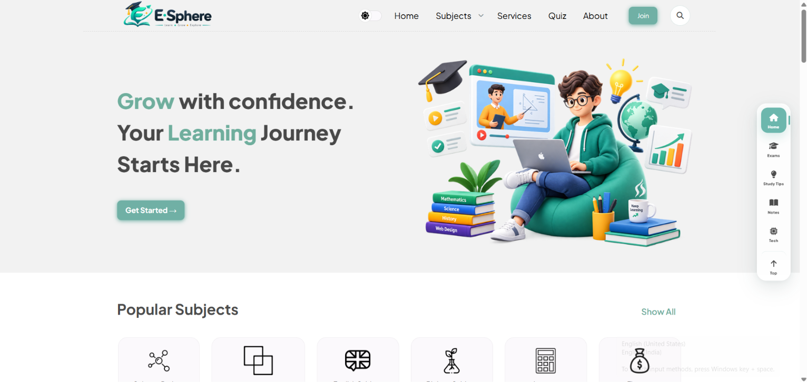

# Frontend Projects — Blogger Templates

A collection of Blogger templates designed and developed using **HTML, CSS, and JavaScript** for education, construction, portfolios, digital agencies, and business websites.

Explore the screenshots and visit the live demos to see each design in action.

---

## 1. Esphere — Educational Blogger Template

An education-focused template for learning resources and educational content.

- **Category:** Education
- **Technologies:** HTML, CSS, JavaScript
- **Live Demo:** [View Esphere](https://esphere-websitedevelopers.blogspot.com/)

---

## 2. Wow Construct — Construction Company Template

A construction-company website design for showcasing services, projects, and company information.

- **Category:** Construction / Business
- **Technologies:** HTML, CSS, JavaScript
- **Live Demo:** [View Wow Construct](https://wowconstruct-websitedevelopers.blogspot.com/)

---

## 3. iPortfolio — Multipurpose Blogger Template

A multipurpose design for portfolio websites, blogs, and education-related content.

- **Category:** Portfolio / Blog / Education
- **Technologies:** HTML, CSS, JavaScript
- **Live Demo:** [View iPortfolio](https://iportfolio-website-developers.blogspot.com/)

---

## 4. Learnify — Education Blogger Template

An education-oriented design for presenting learning resources, study materials, and tutorials.

- **Category:** Education
- **Technologies:** HTML, CSS, JavaScript
- **Live Demo:** [View Learnify](https://blogbuildersofficial.blogspot.com/)

---

## 5. Web Business — Digital Agency Blogger Template

A professional website design for digital agencies, marketing services, and business presentations.

- **Category:** Digital Agency / Marketing
- **Technologies:** HTML, CSS, JavaScript
- **Live Demo:** [View Web Business](https://websitedeveloperstheme.blogspot.com/)

---

## 6. Glow UI — Education Blogger Template

A modern education template featuring a dark-and-light-mode design concept.

- **Category:** Education
- **Technologies:** HTML, CSS, JavaScript
- **Live Demo:** [View Glow UI](https://glowui-websitedevelopers.blogspot.com/)

### Dark Mode Preview

---

## 7. Edupedia — Education Blogger Template

An education template designed for learning resources, tutorials, and educational articles.

- **Category:** Education / Tutorials
- **Technologies:** HTML, CSS, JavaScript
- **Live Demo:** [View Edupedia](https://edupediabloggertheme.blogspot.com/)

---

## 8. Pro Business — Business Blogger Template

A business-oriented template for presenting company information, services, and professional content.

- **Category:** Business
- **Technologies:** HTML, CSS, JavaScript
- **Live Demo:** [View Pro Business](https://wowstudy-websitedevelopers.blogspot.com/)

---

## Skills Demonstrated

- HTML5 and semantic page structure
- CSS3 and responsive layouts
- JavaScript and interactive UI elements
- Frontend design and website customization
- Blogger template development for different niches

## Source Code

The template source code is not included in this repository. This repository showcases the projects through screenshots and live demos.

## Marketplace

Explore more Blogger themes and templates at **[TheCodeBazaar](https://www.thecodebazaar.com/)**.

For purchasing, licensing, or usage terms, please visit the marketplace.

---

**Built by TheCodeBazaar**
